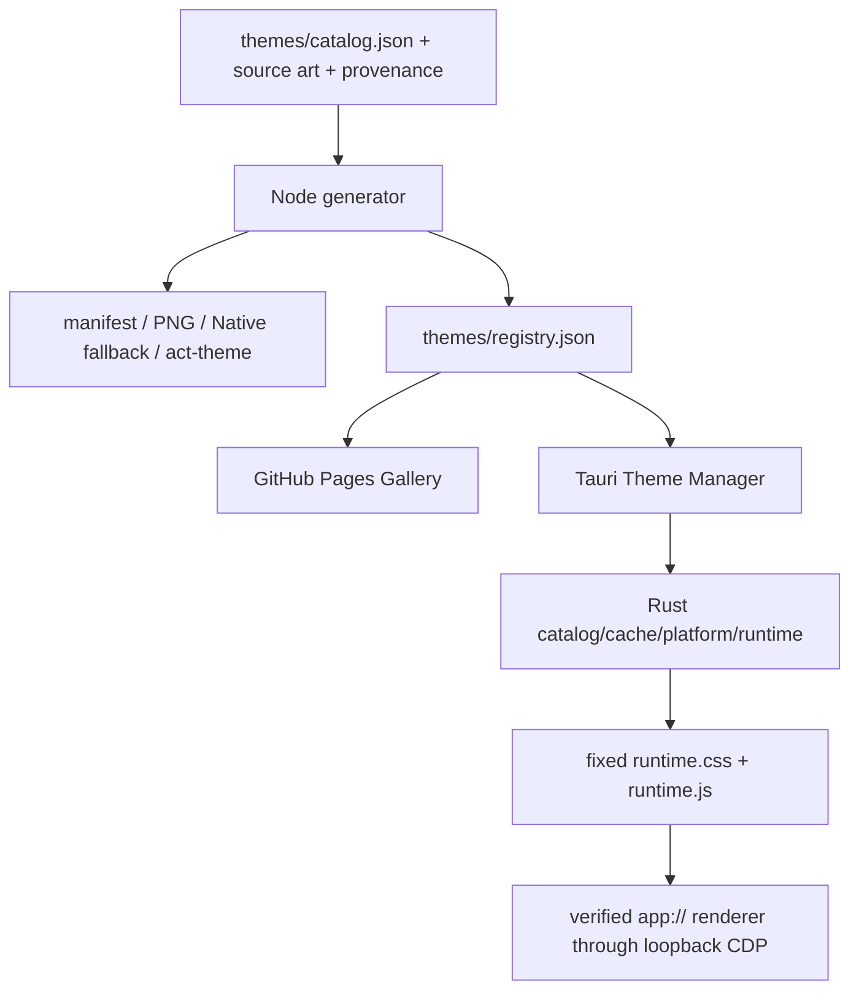

# 02 · 架构与代码质量审查

## 1. 当前系统边界

项目的核心架构方向是正确的：**主题数据不可信，运行时代码可信；Theme Pack 只承载声明式数据，Theme Manager 承担验证、下载、注入与恢复。** 这比把每个主题做成独立 CSS/JS 插件更安全，也更容易建立统一兼容性边界。



可单独打开 [diagrams/architecture.mmd](diagrams/architecture.mmd)。

## 2. 仓库规模与模块职责

| 指标 | 数量/规模 |
|---|---:|
| 文件 | 435 |
| 源码与资产总量 | 287.6 MiB |
| 主题 / 集合 | 68 / 11 |
| 源图 | 68，154.1 MiB |
| 当前实机截图 | 136，128.4 MiB |
| 根 Node 测试文件 | 2 |
| 主要桌面后端 | Rust + Tauri 2 |
| Gallery 前端 | 无框架 HTML/CSS/JS |

| 模块 | 主要职责 | 评价 |
|---|---|---|
| `themes/catalog.json` | 人工维护的主题与集合元数据 | 结构清晰，但承担了越来越多发布元数据职责 |
| `scripts/generate-themes.mjs` | 生成背景、预览、Manifest、归档、Registry | 功能集中、确定性强，但成为性能与内存热点 |
| `scripts/lib/png.mjs` | 纯 JS PNG 编解码、裁切、调色 | 无外部依赖且可控，但算法窄、CPU 成本高 |
| `schemas/` + `validate.mjs` | 主题包和 Registry 结构/关系验证 | 基础扎实，Node/Rust 等价性需要加强 |
| `site/` | Gallery 与 Native 复制入口 | 架构简单、部署稳，媒体层与可访问性需优化 |
| `apps/theme-manager/renderer` | 浏览、筛选、预览、授权与状态 | 依赖少，但单文件状态与 DOM 重建复杂度正在上升 |
| `apps/theme-manager/src-tauri` | Catalog、缓存、平台发现、CDP、持久化 | 安全意识强，事务、错误模型和网络流控需升级 |
| `packages/full-skin` | 固定 CSS/JS 运行时 | 统一运行时是正确方向，选择器和长会话成本需约束 |
| `.github/workflows` | Pages、桌面构建与发布 | 覆盖多平台，但重复生成、权限与可变 Action tag 是明显短板 |

## 3. 架构上值得保留的设计

### 3.1 Theme Pack 不含可执行代码

Canonical archive 只包含 Manifest、两张背景和两份严格 Native 字符串。主题作者不能注入 JavaScript/CSS/Shell，这显著降低了社区贡献的代码执行风险。

### 3.2 运行时代码集中管理

`runtime.css` 与 `runtime.js` 由 Theme Manager 固定拥有并哈希绑定。兼容性修复可以集中发布，而不用更新 68 个主题包。

### 3.3 目标进程和页面不是“只看端口就信任”

后端检查选定 Stable/Beta 包、进程、executable、loopback listener 与 `app://` target。这个验证链应作为不可回退的架构约束。

### 3.4 Registry、截图和素材有哈希与字节数

本次量化中，68 张源图、136 张当前实机截图和 56 张历史 Native 截图的记录哈希全部吻合，未发现重复 source SHA 或重复 job ID。

## 4. 架构债务

### 4.1 生成器承担太多职责并一次性持有过多状态

`scripts/generate-themes.mjs:210-260, 398-425` 同时负责目录构造、渲染、ZIP、Registry、检查与写入。`--check` 也先构建全部文件。结果是任何元数据小改动都可能触发高成本像素工作。

建议拆成四层：

1. **Catalog normalization**：只解析与规范化数据。
2. **Render plan**：为每个主题计算输入指纹与目标文件。
3. **Per-theme executor**：单主题解码一次，生成、校验、原子写入并释放内存。
4. **Registry assembler**：只读取每主题已验证的轻量 metadata，最终原子替换 Registry。

对应 Demo：incremental-generator.mjs。

### 4.2 Node、JSON Schema 和 Rust 形成了三个“近似相同”的契约

Rust 远程 Validator 只验证运行所需子集，这是合理的性能选择，但没有共享测试向量就会逐渐漂移。当前 `nativeSha256` 映射就是一个例子：代码读取 Full Skin capture 中不存在的字段，结果长期为 null。

建议建立 `fixtures/contracts/`：

- `valid-minimal-registry.json`
- 每条 exact-key、路径、hash、byte、mode、package 关系的 invalid fixture
- Node、Schema、Rust 对每个 fixture 必须给出一致 accept/reject 结果
- 生成一个 machine-readable compatibility report，CI 比对三套实现

### 4.3 发布和目录元数据没有单一事实源

根 `package.json` 为 0.1.0，Theme Manager/Cargo 为 0.3.2；Gallery 有 53、106 等旧数字，当前实际为 68 主题/136 模式。`prepare-desktop.mjs` 又硬编码 68。继续手工同步会不断产生漂移。

建议新增 `release/metadata.json` 或由 Catalog 推导：

```json
{
  "catalogRevision": 2026072201,
  "themeCount": 68,
  "modeCount": 136,
  "managerVersion": "0.3.2",
  "channel": "beta",
  "testedTargets": {
    "windowsBeta": "26.715.3651.0",
    "macPersistence": "pending"
  }
}
```

所有 README 徽章、Gallery 文案、installer 版本、release 名称和 capability matrix 都由构建注入，CI 禁止漂移。

### 4.4 文档中的运行时模型与代码已经发生偏差

`docs/20-architecture/adapters.md` 描述 manager-created `` layer，但实际 Runtime 使用 Blob-backed body background。文档仍在表达正确的安全意图，却不能准确解释当前实现。关键架构声明应来自测试或可生成快照，而不是长期手写。

### 4.5 Renderer 单文件逐渐成为隐性状态机

Theme Manager renderer 依赖少是优点，但 `app.js` 同时管理 Catalog、筛选、卡片渲染、对话框、快捷键、持久化状态与 Tauri 命令。每次筛选/模式变化重建卡片，说明“简单前端”已经接近需要模块化的临界点。

不必立刻引入 React/Vue。更低风险的做法是：

- `state.js`：单一状态与 reducer-like updates
- `catalog-view.js`：稳定节点和差量更新
- `dialog-controller.js`：原生 dialog 与焦点
- `shortcuts.js`：上下文与冲突处理
- `bridge.js`：Tauri 命令、错误类型和 telemetry-free diagnostic

## 5. 接口层优化建议

### 5.1 Tauri 命令返回结构化结果

不要用空数组或字符串拼接代表所有失败。建议统一：

```ts
interface CommandResult<T> {
  ok: boolean;
  value?: T;
  error?: {
    code: 'NOT_INSTALLED' | 'PERMISSION_DENIED' | 'COMMAND_FAILED' |
          'PARSE_FAILED' | 'UNSUPPORTED_VERSION' | 'NETWORK_LIMIT' |
          'INJECTION_FAILED' | 'MONITOR_DEGRADED';
    message: string;
    retryable: boolean;
    diagnosticId?: string;
    details?: Record<string, string | number | boolean>;
  };
}
```

Rust 侧使用 enum + `serde`，前端根据 code 显示动作，不再根据英文句子猜状态。

### 5.2 Runtime Session 暴露状态而不是单个 active 布尔值

推荐：`idle → preparing → injecting → verifying → active → degraded → restoring → idle`，失败保留 `lastKnownGood` 与 rollback 结果。详见 [runtime-state-machine.mmd](diagrams/runtime-state-machine.mmd)。

### 5.3 Registry cache 使用原子提交语义

下载临时文件 → 限流与 hash 验证 → fsync/close → rename 覆盖。不要先删除旧缓存再 rename，避免断电或 rename 失败留下空窗。

### 5.4 Renderer 与后端只交换稳定 ID 和状态 DTO

前端不需要知道进程路径、CDP 端口或完整内部错误。敏感诊断应由后端清洗后提供可复制文本，避免未来把用户路径或内部 URL 意外带入 Issue。

## 6. 代码质量结论

代码整体不是“乱”，而是快速成长后出现了**局部过度集中与跨语言契约重复**。最优路线不是大规模重写，而是按 PR 蓝图逐层加边界：先测试契约和结构化错误，再做生成器与 Runtime 重构，最后整理 Renderer 模块。相关切片已在后续实现与当前测试中落地；原始非生产蓝图属于已清理的审查过程材料。
