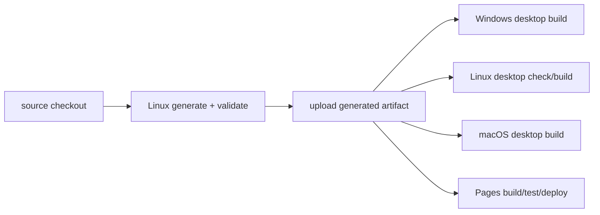

# 04 · 构建性能与 CI 审查

## 1. 结论

构建管线是当前最确定、最容易量化、也最影响贡献者和发布效率的问题。项目已经从少量主题增长到 68 套主题，但生成策略仍接近“每次从零串行重建全部像素与全部归档”。

## 2. 实测结果

| 项目 | 结果 |
|---|---:|
| 代表性 960×540 Light 输出 | 3.2546 秒，594,605 bytes |
| 同主题 2560×1440 Light 输出 | 17.7657 秒，2,912,283 bytes |
| 两个输出合计 | 21.19 秒 |
| 代表性进程最大 RSS | 约 110.5 MB |
| 全量 `npm run generate` | 超过 20 分钟，审查环境终止 |
| 源图总量 | 154.1 MiB |
| 当前 capture 总量 | 128.4 MiB |

这不是跨机器的绝对性能结论，但足以证明冷构建已经超过“快速本地反馈”范围。按一个主题四个像素输出粗略外推，单核冷构建可能接近几十分钟；实际值会受压缩、I/O、CPU 与主题复杂度影响。

## 3. 干净检出命令验证

| 命令 | 结果 | 原因 |
|---|---|---|
| `npm test` | 20 项中 14 通过、6 失败 | 6 项测试直接依赖尚未生成的 `themes/registry.json` 与包 |
| `npm run validate` | 立即失败 | 缺少 `themes/registry.json` |
| `npm run build` | 立即失败 | 缺少 `themes/registry.json` |
| `node --check` 对 JS/MJS | 通过 | 未发现语法错误 |
| `npm run generate` | >20 分钟后终止 | 顺序全量 PNG 生成 |

日志见 the retained verification notes。

README 给出了 `generate → validate → test → build` 的正确顺序，因此这不是“文档完全错误”；真正的问题是命令名字没有表达依赖边界，默认测试不能用来快速验证源码改动。

## 4. 为什么生成器慢

### 4.1 顺序处理所有主题

`scripts/generate-themes.mjs:210-260` 逐主题循环，每个主题至少生成 Light/Dark 的 preview 与 asset。没有基于 CPU/内存的有界并发，也没有按 `--ids` 快速局部运行的完整主路径。

### 4.2 同一源图重复解码与逐像素工作

自研 PNG 路径对每个输出执行解码、bilinear sample、grading、filter 和同步 deflate。高分辨率输出的逐像素 JS 循环和 `level: 9` 同步压缩成为主要 CPU 成本。

### 4.3 输出先保留在全局 Map

生成器把文件 Buffer 放入全局 `Map`，最后统一比较/写入。除了实际 PNG 大小，还会有解码 RGBA、临时数组、ZIP、对象和 V8 overhead。报告不把粗略内存外推当成实测，但架构上可以确认峰值随主题数增长，而不是近似常量。

### 4.4 `--check` 仍先做昂贵工作

检查模式是在生成完整文件集合后比较差异，因此不能成为快速 pre-commit 检查。应先用 fingerprint 判断哪些主题可能变更，只对 miss 重新渲染。

### 4.5 Fingerprint 不完整

当前指纹未覆盖 `focusX/focusY`、`safeArea`、`taskMode` 与完整 grading 常量。未来实现缓存后，这些遗漏会产生错误命中；应先修指纹，再放大缓存使用。

## 5. 自研 PNG 的取舍

### 优点

- 无原生依赖，输出逻辑完全受仓库控制。
- 格式能力和确定性容易限定。
- 安全审计面小于通用图像处理栈。

### 成本

- 只支持 8-bit RGB/RGBA 非交错 PNG。
- bilinear 每像素分配数组，GC 压力高。
- 固定 filter 与同步 level 9 牺牲速度。
- 同一源图无法天然复用多输出管线。
- 后续 AVIF/WebP 缩略图仍需要额外工具。

推荐先做基准实验，而不是直接替换：

1. 用 Sharp/libvips、当前实现和一个平台工具对 10 个代表性主题测试。
2. 比较 deterministic hash、耗时、峰值 RSS、PNG 大小和像素差。
3. 若必须保持当前输出 hash，可让旧 renderer 负责 canonical asset，Sharp 只负责非 canonical thumbnail。
4. 中期再决定 canonical renderer v2，并通过 renderer version 显式失效缓存。

## 6. CI 重复计算

当前一次完整变更可能发生：

- Desktop validate job 生成一次。
- Windows/Linux/macOS 三个平台各生成一次。
- Pages job 再生成一次。
- 三平台分别准备 Desktop 缩略图。

这相当于同一输入最多重复 5 次昂贵生成。更合理的 DAG：

Demo：desktop-optimized.yml。

## 7. 目标构建架构

### 7.1 两类测试

- `npm run test:source`：不依赖生成物，干净检出可运行。
- `npm run test:generated`：要求明确生成 fixture 或下载 CI artifact。
- `npm test` 默认运行 source-only + 极小生成 fixture，不做 68 主题全量像素生成。
- `npm run check:full` 才执行完整 generate/validate/generated tests/build。

Demo：hermetic-test-runner.mjs。

### 7.2 增量与流式生成

每个主题：

1. 规范化输入并计算完整 fingerprint。
2. 命中则复用已验证产物元数据。
3. 未命中则解码一次，生成多个输出。
4. 每个文件写临时路径并原子 rename。
5. 创建 archive 后释放 Buffer。
6. 将轻量 descriptor 交给 Registry assembler。

### 7.3 有界并发

默认并发不应简单等于 CPU 核数。高分辨率 RGBA 每张约 14.1 MiB，多个解码/输出和压缩并发会快速放大内存。建议根据 `min(cpus-1, memoryBudget/perWorkerEstimate)` 推导，并允许 `--concurrency` 覆盖。

### 7.4 进度和性能记录

每次生成输出 JSON summary：总主题、hit/miss、每主题耗时、渲染/压缩/ZIP/写入阶段、峰值 RSS、最大输出。CI 把 summary 作为 artifact，并用基线门槛发现回归。

## 8. 建议性能预算

预算需在项目维护者机器和 GitHub runner 上校准，以下是合理的首版目标：

| 场景 | 建议目标 |
|---|---|
| 无变更暖构建 | 60 秒内完成，0 个像素重渲染 |
| 单主题元数据变更 | 只重建一个主题；60–90 秒内 |
| 单主题源图变更 | 只重建该主题的四个输出与包 |
| 全量冷构建 | 有持续进度；不因主题数线性积累全部 Buffer |
| 峰值 RSS | 设置 CI 上限并保持近似与并发数相关，而非与主题总数相关 |
| PR CI | generate 一次，多 job 复用 |
| Pages 卡片媒体 | 单卡初始候选图建议 <100–150 KB；原始证据图按需加载 |

## 9. 实施顺序

1. 先修干净检出测试契约。
2. CI 生成一次并复用 artifact，立即降低成本。
3. 补完整 fingerprint 与缓存测试。
4. 改成 per-theme 流式写入和单次解码。
5. 再加入有界并发与 worker。
6. 最后评估 canonical renderer v2/Sharp。

这样每一步都能独立回滚，不需要一次性重写生成器。
