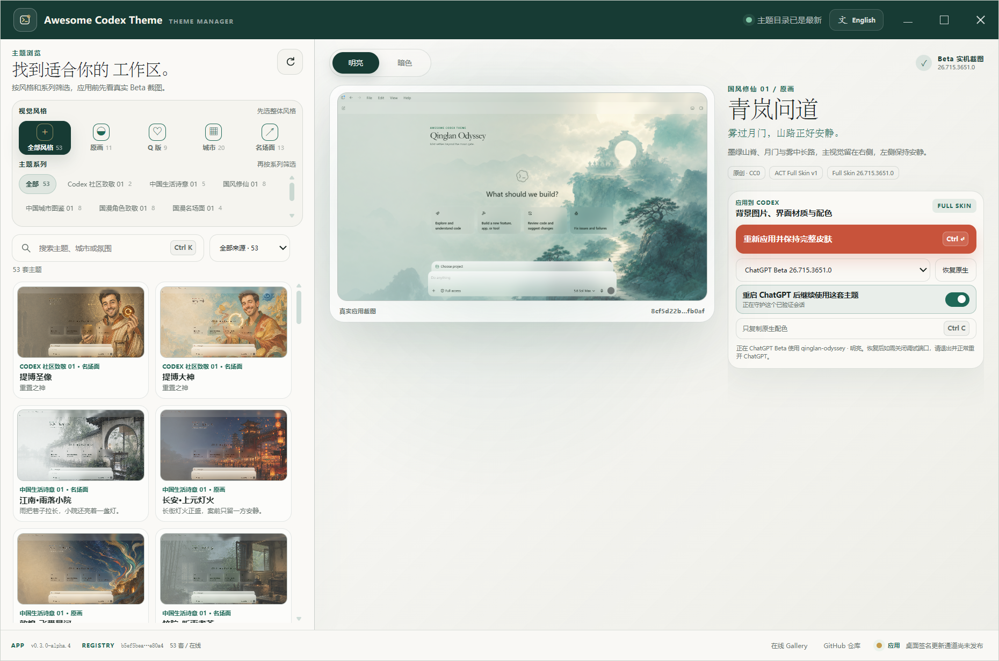

# 05 · UI、UX 与可访问性审查

## 1. 总体判断

Gallery 与 Theme Manager 的视觉方向统一、主题叙事完整、双语内容丰富，产品看起来不像工程 Demo。Theme Manager 的 Windows 截图显示筛选、预览、版本、状态、Apply/Restore 等核心能力都在一个工作区内，信息架构大体合理。

当前 UI 问题主要不是“难看”，而是 **媒体太重、信息密度偏高、详情入口不够显性，以及 ARIA 语义和真实键盘行为不匹配**。这会在触屏、键盘、缩放、小窗口、低性能设备和 68 主题继续增长时放大。

## 2. Gallery 审查

### 做得好的地方

- 依赖少，部署简单，失败面小。
- 使用原生 `<dialog>`，基础可访问性优于自制 overlay。
- 集合、来源、视觉表达、搜索与明暗切换覆盖完整。
- Registry capture 优先体现“真实应用证据”，符合项目价值主张。
- 主题卡片文案与中英文信息较完整。

### 2.1 卡片加载的是证据图，不是列表图

`visualFor` 优先 1440×810 capture。虽然前两张以外使用 `loading=lazy`，但用户滚动后仍会逐步下载大 PNG。136 张当前 capture 总计约 128.4 MiB，Light 模式约 72.7 MiB，Dark 模式约 55.7 MiB。

建议新增明确媒体层：

| 用途 | 格式/尺寸 | 加载策略 |
|---|---|---|
| 卡片 | 320/480 WebP 或 AVIF | lazy + `srcset` + 固定宽高 |
| 高 DPI 卡片/详情首屏 | 960 WebP | 进入 viewport 或打开 dialog 时 |
| 证据查看 | 原始 1440×810 PNG | 用户点击“View verified capture”后 |
| 下载/审计 | 原始 PNG + hash | 不参与普通 Gallery 浏览 |

### 2.2 所有主题卡片一次创建

68 个卡片并不算极端，但每个卡片带图片、标签、按钮和事件时，未来 100–300 主题会产生明显 DOM 与内存成本。先用轻量稳定 DOM、`content-visibility:auto`、分页/虚拟化门槛，而不是等到卡顿再改。

### 2.3 详情入口不够显性

目前主要依赖视觉区域双击或较小箭头。双击在触摸设备不自然，也不容易被发现。建议：

- 整张卡片有清晰的 `View details / 查看详情` 主动作。
- 卡片本身可以是 `<article>`，按钮负责打开，不把整个卡片伪装成复杂 button。
- Enter/Space 在聚焦按钮时打开。
- Download/Native copy 是详情中的次级动作，避免卡片上过多小按钮。

### 2.4 i18n 不完整

部分 `aria-label` 与 `Preview mode` 固定为某一种语言。语言切换不仅要翻译可见文案，也应翻译 `aria-label`、dialog title、错误状态、loading 与空结果信息。

### 2.5 静态数字漂移

无 JS fallback 显示 53，部分能力文案写 106，而当前是 68 主题/136 模式。用户会把这理解为站点数据不可靠。所有数量都应构建注入。

## 3. Theme Manager 审查

### 做得好的地方

- 主题筛选、预览、应用、恢复和状态在同一产品中闭环。
- 明暗模式和 target 选择可见，减少误操作。
- 风险授权没有隐藏，符合项目安全定位。
- 无大型前端框架，离线体积和供应链面较小。

### 3.1 自定义授权对话框焦点不完整

当前 overlay 只把焦点移到确认按钮，没有完整 focus trap、背景 inert 和关闭后焦点恢复。键盘用户可能 Tab 到对话框后面的控件，也可能关闭后失去上下文。

推荐使用原生 `<dialog>`，并保留：

- `showModal()`
- 清晰标题与描述关联
- 关闭前记录 `document.activeElement`
- Cancel 为最安全默认动作
- Escape 关闭
- 关闭后恢复原触发器
- 测试 Tab/Shift+Tab 不逃逸

Demo：accessible-consent-dialog.html 与 accessible-dialog.js。

### 3.2 `tablist` / `listbox` 语义没有完整键盘模型

声明复合控件会让读屏器期待 Arrow/Home/End、焦点与 selection 关系。当前主要依赖点击和全局快捷键。两种修复路线：

- **简化语义：** 筛选项用普通 button，主题列表用 article/list + action button。
- **完整 APG：** 实现 roving tabindex、Arrow、Home/End、typeahead、`aria-selected`、tabpanel 关联。

Demo：roving-listbox.js。

### 3.3 Ctrl/Cmd+C 快捷键有冲突

全局把复制键映射为“复制主题”会覆盖用户选择文字后的正常复制。只有在以下条件全部满足时才应触发：

- 没有非折叠文本选区。
- 焦点不在 input/textarea/contenteditable/button/link/dialog。
- 主预览区处于明确 active 状态。
- 用户已在快捷键帮助中看到该绑定。

更稳妥的是改为 `Ctrl/Cmd+Shift+C` 或提供可配置快捷键。

### 3.4 列表反复重建与图片急切解码

`renderThemeList()` 重新创建 card 和 ``，多个筛选/模式事件都会触发。建议：

1. 初次加载建立稳定卡片 keyed map。
2. 搜索/筛选只切换 hidden/排序，不销毁图片节点。
3. 模式切换更新可见卡片的 src，不重建所有节点。
4. 图片使用本地缩略图、`loading=lazy`、`decoding=async`。
5. 当主题数超过门槛再引入虚拟列表。

Demo：thumbnail-loading.js。

### 3.5 信息密度与字号

截图中的整体构图成熟，但状态、哈希、版本和多个筛选层同时出现；CSS 里有约 7–10px 的 label/status/consent 字体。对高 DPI、125/150/200% 缩放、中文长文案和小窗口不友好。

建议：

- 正文与风险说明至少 12–13px，主要控件 13–14px。
- 哈希只显示短前缀，完整值放详情/复制诊断。
- 提供 Comfortable/Compact 密度，而不是默认极致紧凑。
- 目标应用、版本、持久化状态保留为高优先信息；Provenance 细节放二级面板。

## 4. 视觉层级建议

### Gallery 卡片

1. 主题图与名称。
2. 一句短文案。
3. Collection / Original/Fan Art / Verified capture 三个以内 badge。
4. 明确详情按钮。
5. 其余 license、hash、版本放详情。

### Theme Manager

1. 左侧只负责发现和选择。
2. 中央负责大预览与模式切换。
3. 右侧/底部负责 target、Apply/Restore、状态与诊断。
4. 风险说明只有在首次 Keep 或需要 force close 时出现，不长期占用主界面。

## 5. 错误与状态 UX

后端结构化错误后，前端应区分：

| 状态 | 用户文案 | 动作 |
|---|---|---|
| 未安装 | 未检测到支持的 Stable/Beta | 查看支持范围 |
| 权限/发现失败 | 无法读取本地目标 | 复制安全诊断、重试 |
| 版本待验证 | 检测到新版本，尚未通过本机探测 | Reapply & verify |
| 下载超限/哈希失败 | 主题资源未通过完整性检查 | 保持当前主题，不重试无限次 |
| 注入部分失败 | 新主题未提交，已恢复旧主题 | 查看失败 target、重试 |
| Monitor degraded | 主题监控已停止 | 恢复 Native / 重建监控 |
| 需要强制退出 | 正常关闭超时，可能丢失输入 | Cancel / Force close |

## 6. 可访问性验收矩阵

- 仅键盘完成搜索、筛选、选择主题、切换明暗、打开详情、确认/取消 Apply、恢复 Native。
- Tab 顺序与视觉顺序一致，焦点始终可见。
- 复合控件要么完整实现 APG，要么移除错误 ARIA 角色。
- 200% 缩放不丢内容、不出现双向滚动陷阱。
- Windows High Contrast/forced-colors 可辨识按钮、焦点和错误。
- `prefers-reduced-motion` 关闭非必要动画。
- axe 无 serious/critical，关键流程有手工 NVDA/VoiceOver 验证。
- 文本复制快捷键不被产品快捷键覆盖。

## 7. UI 优先顺序

1. 缩略图层和稳定图片节点。
2. 原生 dialog 与焦点管理。
3. Listbox/tab 语义修正。
4. Ctrl/Cmd+C 冲突。
5. 详情入口和完整 i18n。
6. 字号/密度与高 DPI 测试。
