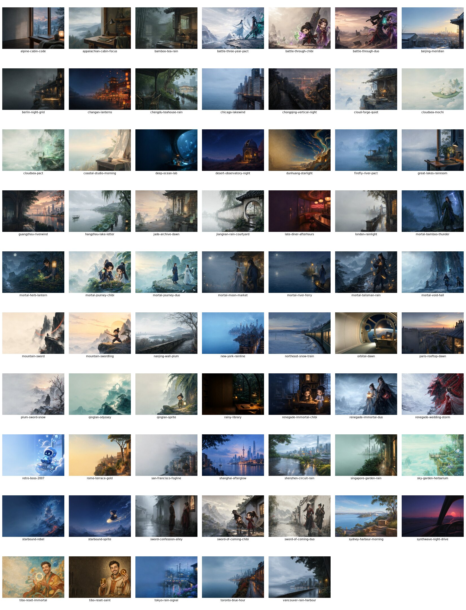
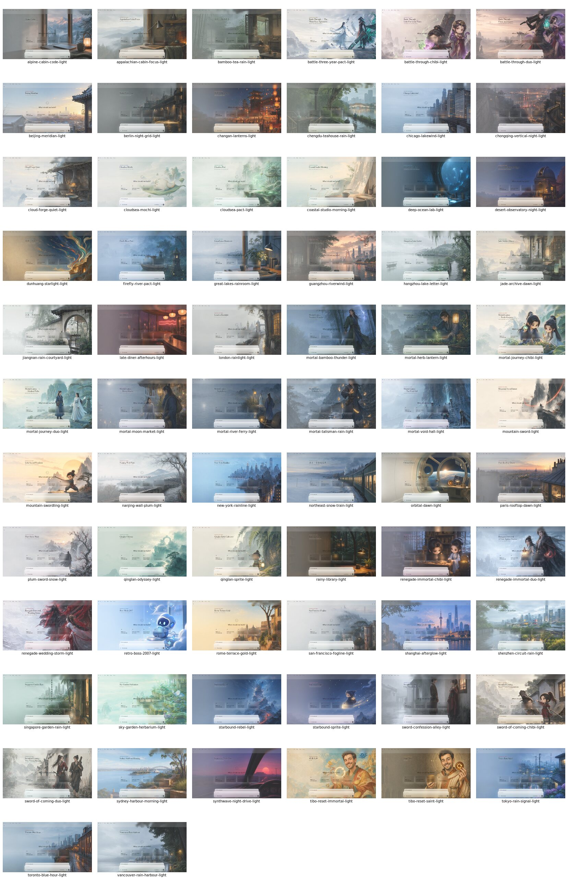
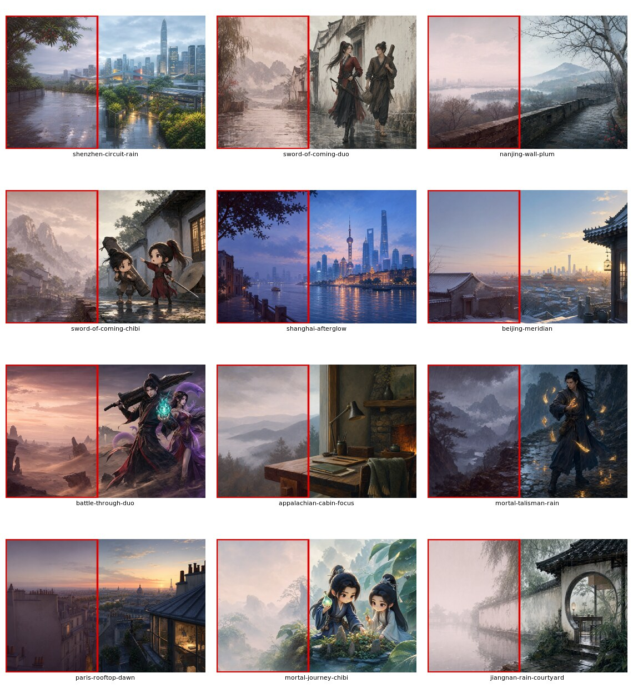

# 06 · 主题视觉质量审查

## 1. 数据集概览

| 指标 | 结果 |
|---|---:|
| 主题 | 68 |
| 明暗模式 | 136 |
| 集合 | 11 |
| Original / Fan Art | 49 / 19 |
| Variant | cinematic 16 / chibi 9 / cityscape 20 / scene 23 |
| Safe area | left 68 / right 0 / center 0 |
| Task mode | ambient 63 / banner 5 |
| 源图格式 | 68/68 为 1536×1024 RGB PNG |
| 当前 capture | 136/136 为 1440×810 PNG |

项目的视觉覆盖范围很广：原创仙侠、中国城市、世界城市、日常诗意、全球工作区、美国工作区、社区致敬与披露的非商业同人。统一的构图语言和 translucent material 让集合之间仍然像一个产品，而不是随机壁纸合集。

## 2. 视觉体系优点

### 2.1 系列与变体体系清楚

Collection、variant、双语名称、短文案、tags 和 rights profile 使主题可以被发现、筛选和解释。不同集合有明确叙事方向，原创与同人没有混在一个模糊授权状态里。

### 2.2 Light/Dark 不是简单反色

每个模式有独立 Token 和对应实机截图。文本对 background/surface、muted 对 background/surface、accent label 对 accent 均通过当前 Validator 门槛，最低 text/background 仍达到约 11.53:1。

### 2.3 实机证据体系强

136 张 capture 与 exact app version、背景 hash、runtime hash、byte count 和 readback 绑定。视觉审查能够针对真实 UI 覆盖，而不是只看源图。

## 3. 裁切与焦点问题

源图是 3:2，目标 Full Skin 是 16:9。当前 center-cover 会裁掉约 15.625% 的垂直内容；2560×1440 输出还会把 1536 宽源图放大 1.667 倍。Catalog 虽包含 `focusX/focusY`，Renderer 没有使用它们。

这会产生三类问题：

1. 头部、灯笼、建筑顶端或地景可能被固定中心裁切截断。
2. 相同源图在 preview 和 asset 中缺少可控视觉焦点。
3. 为 2.5K 输出放大可能放大 AI 细节瑕疵、压缩噪声和笔触边缘。

建议：

- 新主题源图直接采用 16:9，建议至少 2560×1440 或更高。
- 旧主题使用 focus-aware cover crop；视觉批准后再更换 canonical renderer version。
- 保留原始 1536×1024 作为 provenance source，不要静默覆盖。
- 先生成低成本 crop contact sheet，人工批准后再生成所有模式。

Demo：focal-aware-render.mjs。

## 4. 安全区问题

68/68 主题都声明 left，Renderer 的 wash 也固定强化左侧。项目当前 UI 恰好主要把导航和任务内容放在左/中区域，因此这套规则在早期有效；但它已经从“设计选择”变成“未被测试的假设”。

量化中的左侧复杂度是基于边缘/亮度变化的启发式指标，只用于筛查，不等同于人工可读性结论。最高的一组包括：

| 排名 | Theme ID | 启发式复杂度 |
|---:|---|---:|
| 1 | `shenzhen-circuit-rain` | 0.314 |
| 2 | `sword-of-coming-duo` | 0.303 |
| 3 | `nanjing-wall-plum` | 0.297 |
| 4 | `sword-of-coming-chibi` | 0.263 |
| 5 | `shanghai-afterglow` | 0.241 |
| 6 | `beijing-meridian` | 0.230 |
| 7 | `battle-through-duo` | 0.229 |
| 8 | `appalachian-cabin-focus` | 0.220 |
| 9 | `mortal-talisman-rain` | 0.212 |
| 10 | `paris-rooftop-dawn` | 0.205 |
| 11 | `mortal-journey-chibi` | 0.203 |
| 12 | `jiangnan-rain-courtyard` | 0.199 |

建议建立三种层次的 Gate：

1. **Source heatmap**：导航区、标题区、任务卡、composer 分别计算边缘、局部对比和亮点密度。
2. **UI fixture overlay**：至少有 Home、长任务、Diff、Settings、Dialog 五套占位模板。
3. **Real capture approval**：固定版本真实应用截图由人工勾选 readable / needs grading / reject。

同时允许 `safeArea=right|center|none`，并让 grading 按方向生效。主题不必全部服从同一个构图，只需保证实际工作区可读。

## 5. Token 对比度

| 组合 | 最低值 | 低于门槛数量 | 解释 |
|---|---:|---:|---|
| text / background | 11.53 | 0 | 很强 |
| text / surface | 13.13 | 0 | 很强 |
| text / surfaceAlt | 8.94 | 0 | 通过 |
| muted / background | 4.78 | 0 | 通过当前门槛 |
| muted / surface | 5.19 | 0 | 通过当前门槛 |
| muted / surfaceAlt | 3.76 | 23 | 现有 Validator 未覆盖，主要为 Light 模式 |
| accentContrast / accent | 5.01 | 0 | 通过 |
| accent / background | 4.45 | 0 | 通过 3:1 |
| border / background | 1.65 | 128 | 装饰线不一定必须 3:1；交互边界不能只依赖它 |
| border / surface | 1.80 | 136 | 同上 |

不能简单把所有 border failure 都判为 WCAG 违规。关键是建立 **token-use matrix**：

- 装饰分隔线允许较低对比。
- 输入框、按钮、焦点、选中边界若只靠 border 区分，应达到非文本对比要求。
- `surfaceAlt` 上的 muted 文字应提高对比，或避免用 muted 承载必要信息。
- error/warning/success 不应被通用 text/accent 覆盖。

完整数据：[token-contrast.csv](metrics/token-contrast.csv)。

## 6. 主题一致性与差异化

### 当前优势

- 城市场景与工作区场景覆盖全球，英文用户有真实可理解的选择。
- 仙侠、日常诗意和 chibi 形成中文社区辨识度。
- 大多数主题主体靠右、工作区相对安静，符合产品定位。
- 双语短文案不是机械翻译，主题可被描述和记忆。

### 潜在问题

- 全部 left safe area 会让构图逐渐同质化。
- 49 Original + 19 Fan Art 的比例尚可，但 Fan Art 在传播中更容易吸引点击，也更容易模糊项目原创品牌，应在 Gallery 视觉上持续明确披露。
- 多个高细节雨景、灯笼、城市霓虹在 Light capture 中 PNG 更大，也更容易与 UI 竞争。
- chibi/cinematic/scene/cityscape 的分类是视觉表达，不代表可读性；需要独立 quality score。

## 7. 新主题质量标准建议

### 素材源

- 默认 16:9，至少 2560×1440。
- 不烘焙 UI、Logo、文字、水印和窗口边框。
- 提交 raw/source provenance、prompt、source hash 和人工审核 attestation。
- 明确主体焦点、可裁切范围和安全区方向。

### 自动检查

- exact dimensions/format/hash。
- alpha、interlace、色彩空间与异常 chunk 检查。
- 多区域复杂度、亮点和局部对比筛查。
- Token-use matrix 对比度。
- 生成预览文件大小预算。
- 与现有 source perceptual duplicate 检查。

### 人工检查

- Home、Task、Diff、Settings、Dialog、长文本、空状态。
- Light/Dark 与高 DPI。
- 主体不被裁切、UI 不遮挡关键脸部/文字。
- 不含官方资产、他人同人图、可识别真人或品牌素材。
- Fan Art 披露与非商业限制可见。

## 8. 视觉优化优先级

1. 先加 thumbnail pipeline，不改变 canonical 主题外观。
2. 加安全区 heatmap 和 fixture，不立即批量重渲染。
3. 实现 focal crop renderer v2，并对 68 套逐批批准。
4. 修 `muted/surfaceAlt` 与真实交互边界。
5. 新主题转向 16:9 高分辨率源图。
6. 引入 right/center 主题，扩大构图语言。
